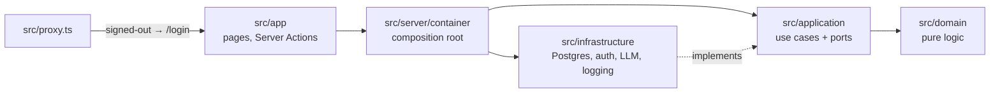

# StudyForge AI

A private, source-grounded study guide. Upload your own notes, let an LLM propose concepts, terms, how-tos and questions, then approve each one next to the exact source excerpt it came from before it reaches your library.

> **Status:** early build. The scaffold, owner login, database and test harness are in place; extraction, the review queue and the study tools are in progress.

## Stack

Next.js 16 (App Router) · TypeScript (strict) · Tailwind CSS 4 · Postgres + Drizzle ORM · zod · Vitest · Playwright · GitHub Actions. LLM: Google Gemini free tier behind a provider interface, with a mock provider for tests.

## Architecture



Dependencies point inwards: use cases depend on port interfaces, and infrastructure implements them. That keeps the core testable without a database or a model.

## Privacy

- Owner-only: the password comes from `OWNER_PASSWORD` and is stored as an scrypt hash, created on first boot and re-hashed if the value changes.
- Sessions are httpOnly, SameSite cookies signed with HMAC-SHA256 (`SESSION_SECRET`), valid for 7 days.
- `src/proxy.ts` sends every signed-out request to the login screen (APIs get `401`), and each page and action checks the session again.
- Failed logins are rate-limited (5 per 15 minutes per client). Pages are served with `noindex` and anti-framing headers.

## Local setup

Requires Node 22+ and Docker.

```bash
cp .env.example .env.local   # then fill in the values
npm install
npm run db:up                # Postgres in Docker
npm run db:migrate
npm run dev                  # http://localhost:3000
```

## Tests

```bash
npm run lint && npm run typecheck && npm test   # unit tests (Vitest)
npx playwright install chromium && npm run test:e2e
```

CI runs lint, typecheck, unit tests, a production build and the Playwright suite against Postgres, with the LLM mocked.

## Environment variables

| Name | Purpose |
|---|---|
| `DATABASE_URL` | Postgres connection string |
| `OWNER_PASSWORD` | The single owner's sign-in password |
| `SESSION_SECRET` | ≥ 32 random characters for signing session cookies |
| `LLM_PROVIDER` | `gemini` (default) or `mock` |
| `GEMINI_API_KEY` | Google AI Studio key (free tier) |
| `GEMINI_MODEL` | A Flash / Flash-Lite model, e.g. `gemini-3.5-flash-lite` |

## License

[MIT](LICENSE)
