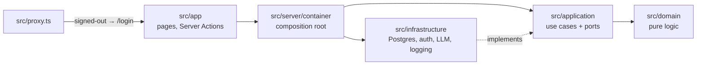

# StudyForge AI

A private, source-grounded study guide. Upload your own notes, let an LLM propose concepts, terms, how-tos and questions, then approve each one next to the exact source excerpt it came from before it reaches your library.

> **Status:** upload, extraction, the word-for-word check, the review queue and the searchable library, concept pages, flashcards and focused study sessions work end to end. Quizzes and the dashboard are next.

## How it works

1. **Upload** a PDF, Markdown or text file. The server extracts the text once and stores it; every offset in the app points into that exact string.
2. **Chunk** it by heading or Q&A pair (about 1,500 words per chunk), so each model call stays small.
3. **Extract** with Gemini: concepts, terms, systems, processes, how-tos and questions to investigate. Each item carries an `excerpt` the model must copy word for word. Chunks run in a background queue that is throttled for the free tier, backs off exponentially on `429`s, caches responses by chunk hash and can resume after a restart.
4. **Check** every excerpt against the source (below). Items that fail never reach the queue; they are counted on a "Rejected: excerpt not found" panel.
5. **Review** each item beside its excerpt highlighted in the source: approve, edit inline, tag, merge (keeping every excerpt) or discard, one at a time or in bulk, with keyboard shortcuts. Only approved items reach the library.
6. **Find** anything in the library: approved items grouped by type, filtered by tag or source, with Postgres full-text search over titles, tags, the generated wording and the excerpts. Each word may be a prefix ("concur" finds "concurrency"), titles rank above excerpt-only matches, and matches are marked inside the full, untrimmed excerpt. The search document is written in the same transaction as the approval, by one SQL function (`item_search_document`) that the migration also uses to backfill.
7. **Read** an item on its own page: the generated summary, a question to check yourself (or numbered steps for how-to guides and processes written as a list), every source fact shown in the surrounding text of its own document with an "Open in source" link that highlights the exact span, and related items that share tags or a source.
8. **Practise** with flashcards made only from approved items, for everything, one tag or one source. The question comes first; the answer is shown with its source facts. Grades follow SM-2 (Again, Hard, Good, Easy; keys 1–4), and each button shows when the card would come back. Again brings a card back after 10 minutes. A second grade of the same showing, from a double click or a second tab, is ignored, so a card is never scheduled twice for one answer.
9. **Focus** with a timed study session: pick everything, a tag or a source and 5–25 minutes. You get due cards, then new ones, each once, with a countdown, until the time is up, nothing is left, or you finish. The summary counts what you studied and how you graded it, and the reason the session ended is stored with it. Answers are checked against the session under a row lock: once it has ended, passed its deadline, or already covered an item, a late answer from another tab is refused, so a finished summary never changes. Quiz questions join the mix when the quiz lands.

## Understanding dashboard

The **Dashboard** tracks mastery by tag and source, due and new cards, UTC study streaks, quiz accuracy, review decisions and excerpt rejection rate. An established card means at least two consecutive successful SM-2 reviews; this is a scheduling signal, not a claim of expertise. Empty metrics are explicit, and extraction totals remain stable after merges.

## Demo

Choose **Load original demo note** on the dashboard, or run `npm run seed:demo`. It imports the redistributable note in `demo/swift-value-semantics.md`, runs the same chunking, mock extraction and word-for-word verification as an upload, and leaves verified items pending for the owner to review. Loading it again resumes or returns the same source, including under concurrent requests.

## Backup

The dashboard downloads a versioned JSON snapshot under the owner session. It uses a repeatable-read transaction and includes source text, extraction progress and rejections, items and excerpts, review history, spaced-repetition state, quizzes and study sessions. Password hashes, environment values and the LLM response cache are excluded. The response is private and never cached.

## Quizzes

Open **Quiz** to practice approved items, optionally selected by tag or source. Each question offers up to four distinct answers reused from reviewed items. All options are labelled **Generated interpretation**; correctness and source excerpts are revealed only after answering. A round visits each item once and records its first submitted answer, including concurrent double clicks. At least two distinct approved answers are needed in the selection.

## The word-for-word check

The model's wording (title, summary, question, answer) is always labelled **Generated interpretation**. The excerpt is the **Source fact**, and it is only accepted if it really is in the source:

- Both texts are normalised for differences that don't change the words: whitespace and line breaks, PDF line-break hyphenation (`modi-\nfied`), smart quotes and dashes, ligatures (`fi`, and PDFs that drop them entirely), case, bullets and code ticks.
- Normalisation keeps a map from every normalised character back to the original, so the stored excerpt is the exact source slice with its character range.
- Anything else (a paraphrase, a "fixed" typo, a merged quote, an invented sentence) is rejected. Unit tests cover each case, including true negatives.

## Stack

Next.js 16 (App Router) · TypeScript (strict) · Tailwind CSS 4 · Postgres + Drizzle ORM · zod · Vitest · Playwright · GitHub Actions. LLM: Google Gemini free tier behind a provider interface, with a mock provider for tests.

## Architecture



Dependencies point inwards: use cases depend on port interfaces, and infrastructure implements them. That keeps the core testable without a database or a model.

## Privacy

- Owner-only: the password comes from `OWNER_PASSWORD` and is stored as an scrypt hash, created on first boot and re-hashed if the value changes.
- Sessions are httpOnly, SameSite cookies signed with HMAC-SHA256 (`SESSION_SECRET`), valid for 7 days.
- `src/proxy.ts` sends every signed-out request to the login screen (APIs get `401`), and each page and action checks the session again.
- Failed logins are rate-limited (5 per 15 minutes per client). Pages are served with `noindex` and anti-framing headers.

## Local setup

Requires Node 22+ and Docker.

```bash
cp .env.example .env.local   # then fill in the values
npm install
npm run db:up                # Postgres in Docker
npm run db:migrate
npm run dev                  # http://localhost:3000
```

## Tests

```bash
npm run lint && npm run typecheck && npm test   # unit tests (Vitest)
npm run test:int                                # Postgres integration tests (uses <db>_test)
npx playwright install chromium && npm run test:e2e   # end to end (uses <db>_e2e, mocked LLM)
```

CI runs lint, typecheck, unit tests, integration tests, a production build and the Playwright suite against Postgres, with the LLM mocked. Test databases are separate from your data and created automatically.

## Environment variables

| Name                      | Purpose                                                         |
| ------------------------- | --------------------------------------------------------------- |
| `DATABASE_URL`            | Postgres connection string                                      |
| `OWNER_PASSWORD`          | The single owner's sign-in password                             |
| `SESSION_SECRET`          | ≥ 32 random characters for signing session cookies              |
| `LLM_PROVIDER`            | `gemini` (default) or `mock`                                    |
| `GEMINI_API_KEY`          | Google AI Studio key (free tier)                                |
| `GEMINI_MODEL`            | A Flash / Flash-Lite model, e.g. `gemini-3.5-flash-lite`        |
| `LLM_REQUESTS_PER_MINUTE` | Optional. Spacing for model calls (default 10; 0 with the mock) |

## Deploy

The checked-in `.replit` uses Node 22, installs from the lockfile, builds Next.js, applies migrations and starts on port 3000. The owner-facing [Replit deployment guide](docs/DEPLOY.md) covers production database setup, secrets, privacy, persistence, backup and rollback checks. Deployment and secret entry remain owner actions.

## Explaining the project

The [interview guide](docs/INTERVIEW_GUIDE.md) covers the architecture, invariants, trade-offs, production bugs, likely questions and a safe demonstration using only original demo material.

## License

[MIT](LICENSE)
