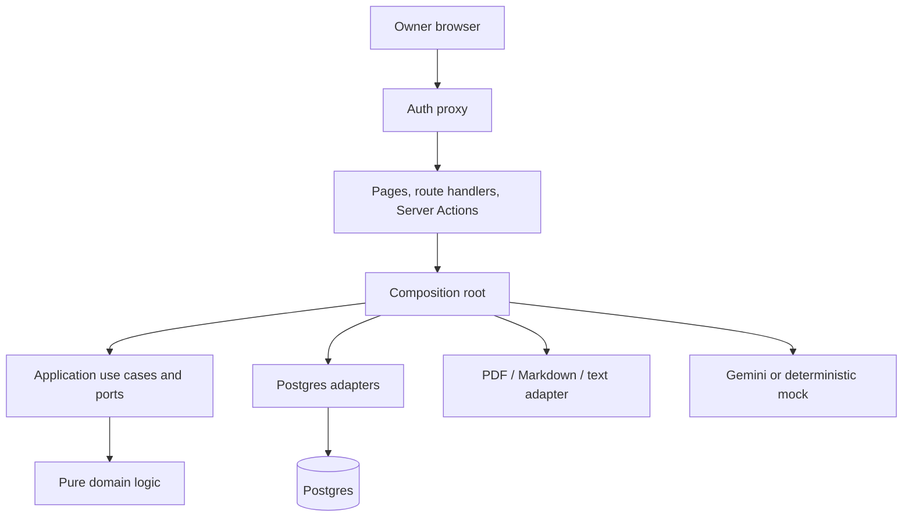

# StudyForge AI interview guide

Use this guide to explain the project in your own words. Lead with the user problem and the trust boundary, then show how the architecture supports it.

## The one-minute explanation

StudyForge AI turns notes the owner is allowed to use into a private study system. An LLM proposes concepts, questions and how-to steps, but nothing enters the library automatically. Every proposal carries a claimed quotation. The server normalizes the quotation and source while retaining an offset map, rejects anything it cannot locate word for word, and puts verified proposals beside the highlighted source for owner review. Only approved items can become searchable pages, flashcards, quiz questions or focused study sessions.

The app is a Next.js 16 server application with strict TypeScript and Postgres through Drizzle. Domain code contains pure matching, chunking, scheduling and quiz logic. Application use cases depend on ports. Infrastructure adapters implement those ports for Postgres, documents, authentication and LLMs. The composition root is the only place that wires them together. Vitest covers pure behavior, real-Postgres tests cover transactions and races, and Playwright covers signed-in user journeys with a mock model, against a production build in CI.

## Architecture you can draw

Dependencies point inward. The UI knows use-case results; use cases know interfaces; domain logic knows neither Next.js nor Postgres. The adapters depend on those interfaces, and `src/server/container.ts` chooses concrete implementations.

## The workflow and its invariants

1. Upload stores one canonical source string. Every later character offset points into that exact value.
2. Chunking prefers headings and question boundaries, caps chunks near 1,500 words, and splits pathological long lines.
3. Extraction asks the provider for structured JSON and validates it with zod. Calls are cached, throttled across sources, retried after rate limits and resumable from database state.
4. The word-for-word verifier normalizes whitespace, PDF hyphenation, punctuation variants and ligatures while mapping normalized characters back to the original source. Failed excerpts are rejected before review.
5. Review mutations check `pending` in the same transaction as the write. Approval and edits cannot both win a race. Cross-source merges retain each excerpt's own source.
6. Approval updates the full-text search document transactionally. Unapproved items never appear in study tools.
7. Flashcard grading checks the displayed version before writing. Session answers also lock the active session and verify deadline, scope and prior activity.
8. Quiz answers lock the question, re-check every referenced item is approved, record only the first answer and reveal source excerpts only afterward.
9. A session stores its end reason. A later visit cannot rewrite history because availability changed.
10. The backup reads one repeatable snapshot and excludes credentials, environment values and LLM response cache.

## Important design choices

### Human approval before retrieval

The app treats model output as a proposal. This adds friction, but it prevents generated wording from silently becoming study truth. It also produces a useful audit trail: verified, rejected, edited, merged, approved and discarded.

### Exact excerpts plus generated interpretations

The exact excerpt remains the evidence. Titles, summaries, questions, answers and quiz options are labelled generated interpretation even when their wording was approved. Approval means the owner accepted it for study; it does not turn a paraphrase into a quotation.

### Postgres full-text search

Search is private, local to the database and fast enough without another service. Weighted vectors rank titles above excerpt-only matches. Prefix queries help partial recall. A separate search table adds write complexity, so approval and indexing happen together and migrations can rebuild it deterministically.

### SM-2 as a transparent baseline

SM-2 is small, inspectable and works offline. The implementation exposes Again, Hard, Good and Easy, due/new counts and the stored schedule. It is a scheduling heuristic rather than proof of mastery; the dashboard says so.

### Reviewed answers as quiz distractors

Distractors reuse answers from other approved items and remain labelled generated interpretation. Sampling avoids repeating the same earliest-approved choices. This is safer than asking the model to invent plausible facts during study, though semantic similarity could be improved later.

### In-process extraction queue

For a single-owner project, a persisted chunk state plus an in-process runner is simpler than a separate queue service. Progress survives a restart because chunk states live in Postgres, and the owner resumes without redoing finished or cached work. The trade-off shows up in hosting: the app is published as one always-on Reserved VM, because a scale-to-zero, multi-instance host would pause the background queue and split the in-memory login limiter. At larger scale, move leases and workers into a durable job system.

### Owner-only authentication

One scrypt-hashed password and an HMAC-signed httpOnly cookie match the single-user requirement. The proxy blocks navigation, while every page, action and route checks again at the data boundary. This is intentionally smaller than multi-user identity, authorization and tenant isolation.

## Bugs worth discussing

- A broad text replacement once corrupted a schema comment. The fix was narrow edits plus formatting, migrations and full checks.
- Merged excerpts initially displayed against one document. The model changed so every excerpt carries its own source identity, with an end-to-end cross-source regression.
- Approval could race an edit, tag or merge. Status checks moved into locked database transactions; race tests assert exactly one side wins.
- Rate limiting was per source, allowing simultaneous provider calls. A shared reservation slot serializes calls across sources.
- A long single line bypassed chunk limits. Word-boundary splitting now guarantees the cap.
- Session answers from stale tabs could land after Finish. Answer writes and session endings now serialize on the session row.
- Recomputing an ended session's reason made history change on revisit. The reason is now persisted with a database check constraint.
- `instanceof` failed across Next.js module layers for container-created errors. A marker identifies safe owner-facing errors across bundles, with a two-tab browser regression.

## Likely interview questions

### How do you prevent hallucinations?

I do not claim to prevent the model from generating them. I constrain their effect. Structured output is validated, the claimed excerpt must match stored source text, failed evidence is rejected, and verified proposals still require owner approval. The UI keeps evidence and interpretation visibly separate.

### Why is normalization safe?

The normalizer handles presentation differences common in PDFs, such as line breaks, hyphenation, smart punctuation and ligatures. It never stores the normalized text as evidence. It keeps a character map back to the canonical source and stores the exact original slice. Paraphrases and stitched quotations still fail.

### Where are the transaction boundaries?

They surround decisions whose precondition and write must be atomic: approval plus search indexing; edit/tag/merge while pending; question first-answer-wins; card version check plus review; session activity guard plus answer; stable session ending; and repeatable-read backup. The race tests use real Postgres because an in-memory fake cannot establish lock behavior.

### How do you avoid deadlocks?

Competing study paths lock in a consistent order: referenced item rows first, then the session row. Merge locks item IDs in deterministic order. Transactions stay short and perform no model or network calls.

### What happens when the model quota is exhausted?

Chunks are durable records. The runner spaces calls, retries rate limits with exponential backoff, caches by provider/model/prompt-version/chunk hash and marks failures. The owner can resume without redoing successful or cached work.

### Why not embeddings or RAG?

The main task is trustworthy extraction, review and recall over a modest private corpus. Postgres full-text search is explainable and operationally small. Embeddings would add a provider, privacy considerations, cost and evaluation work. They become useful when semantic recall beyond vocabulary matching is demonstrated as a real need.

### What does the dashboard's mastery number mean?

It is deliberately modest: an item is established after at least two consecutive successful SM-2 reviews. Tags can overlap and the source is the item's primary source. Quiz accuracy is separate. The UI calls this a study signal, not a knowledge assessment.

### How would you make it multi-user?

Add user and membership identities, attach an owner or tenant key to every row, enforce row-level authorization in every port, rotate sessions, add account recovery and CSRF analysis, isolate rate limits and queues per tenant, and test cross-tenant access at the database and HTTP layers. I would not retrofit this by trusting UI filters.

### How would you scale extraction?

Replace the in-process runner with durable jobs using leases, visibility timeouts and idempotency keys. Workers would claim chunks, call providers outside database transactions and commit verified results atomically. The existing chunk state and cache key already define most of that contract.

### What would you improve next?

Evaluate quiz distractor quality, add a versioned restore path for backups, measure matcher false positives/negatives on an approved corpus, add OCR for scanned PDFs, introduce accessible visual regression snapshots, and replace the single-process login limiter with a shared store if the app runs on several instances.

## Demonstration script

1. Open a private window and show that only login is visible.
2. Load the original demo note from the dashboard.
3. Show one deliberately rejected invented excerpt and the pending verified items.
4. Edit and approve an item beside its highlighted source.
5. Search it in the library and open its source-linked page.
6. Grade a flashcard, answer a quiz and show that evidence appears only after the answer.
7. Run a focused session and return to the dashboard.
8. Download the JSON backup and explain what is intentionally excluded.

Keep the demo on original repository material. The owner's private PDFs and notes do not belong in screenshots, seed data or a public showcase.
